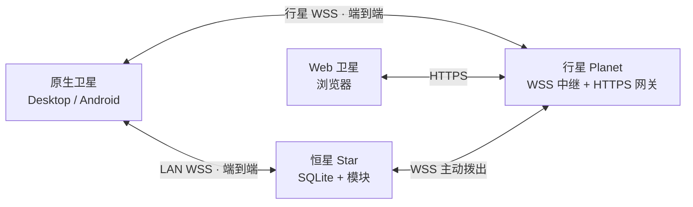

# 00 · 一页纸总览

家庭模块化 ERP。数据放在家里的**恒星**，公网只做中继/网关，客户端分**原生**与 **Web**。

## 只记三句话

1. **恒星是唯一数据源**；行星不持久化业务数据。
2. **原生端是端到端加密**；Web 经行星 HTTPS 网关，行星能看到明文。
3. **动态模块只服务原生端**；Web 是固定壳，没有模块自定义页面。

## 五个关键取舍

| 取舍 | 选择 | 代价 |
|---|---|---|
| 数据位置 | 只在家中的恒星 | 恒星离线时不可用（v1 在线优先） |
| 传输信任 | 原生 E2E；Web 走行星网关 | Web 信任行星，不宜承载高敏感操作 |
| 客户端模块化 | `.hmod` 动态加载，仅原生 | Web 固定页面，模块不能扩展 Web UI |
| 数据层 | SQLite + 单 `data/` 目录 | 单写者；模块不能上 ORM |
| 离线 | v1 在线优先 | 无网不能改数据；离线/CRDT 后置 |

## 推荐阅读顺序

1. 本文 + [README](../README.md)（5 分钟）
2. [01-architecture.md](01-architecture.md) §2–§4：角色、拓扑、连接（15 分钟）
3. [07-decisions.md](07-decisions.md) 的 D1 / D3 / D21 / D22：为什么这样取舍（10 分钟）
4. [02-protocol.md](02-protocol.md) §1、§2.3、§3.6：外层帧、握手、Web 网关（15 分钟）
5. 其余按需查：
   - 做模块看 [03-modules.md](03-modules.md)
   - 改数据看 [04-data.md](04-data.md)
   - 做安全评审看 [05-security.md](05-security.md)
   - 排期看 [06-roadmap.md](06-roadmap.md)

## 现在到哪了

设计基线已完成，尚无运行代码。下一步是 M0：Gradle 脚手架、模块骨架、Web 构建链。
