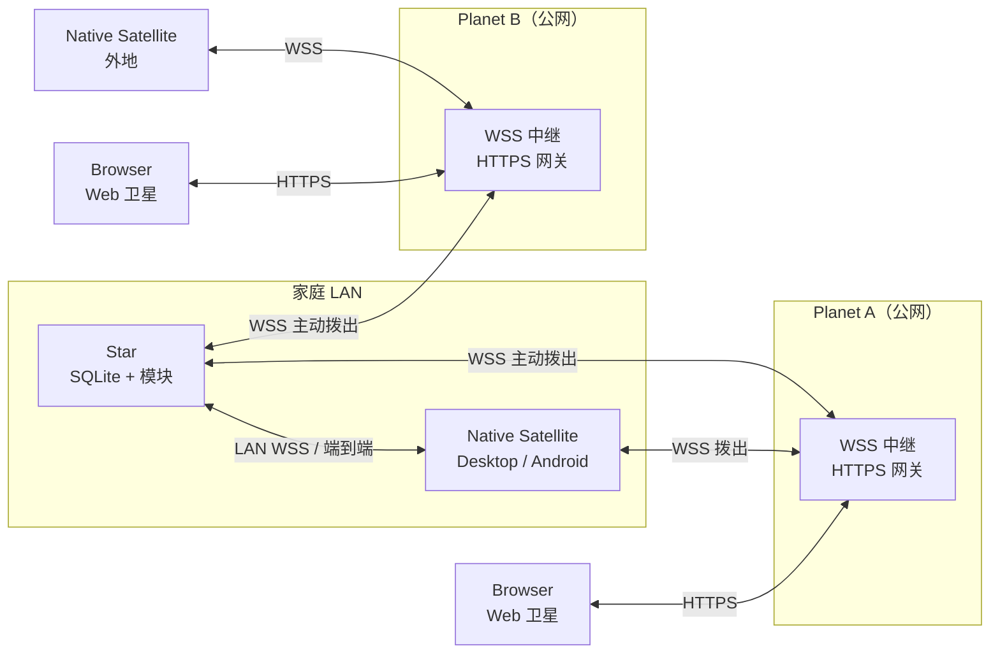
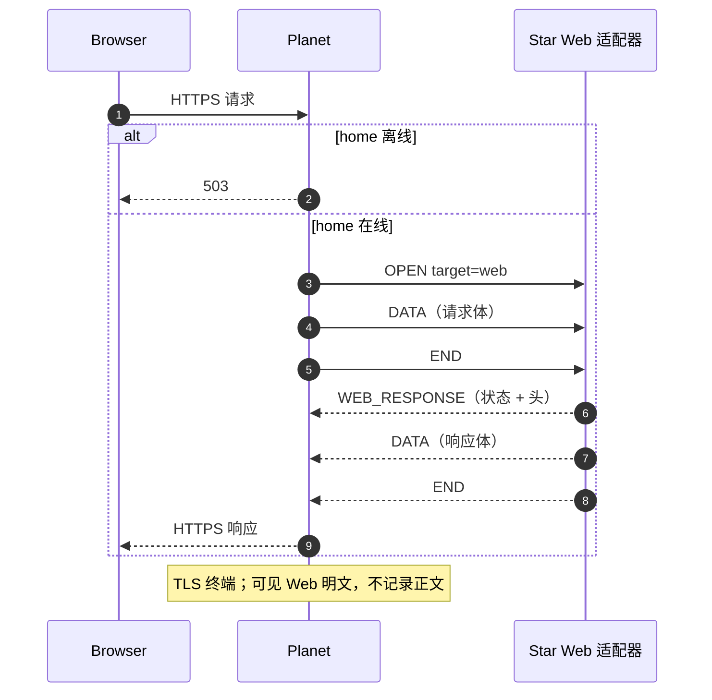

# 01 · 架构

## 1. 目标与非目标

### 目标

1. 家庭数据**只存放在家中**的恒星服务器；公网侧不持久化业务数据。
2. 原生卫星在家走局域网直连，在外自动经行星中继；Web 卫星经行星 HTTPS 网关。
3. 功能以模块交付；服务端模块与**原生客户端 UI** 都能安装、升级、卸载。
4. 一个 `data/` 目录 = 完整数据单元；备份/迁移靠拷贝目录。
5. Android 与桌面共享大部分 Kotlin / Compose 代码；Web 用原生 TypeScript/HTML/CSS。

### 非目标（v1）

- 多家庭、多租户、SaaS。
- 离线优先与 CRDT 多端冲突合并（v1 在线为主，仅缓存壳数据）。
- 模块代码沙箱（模块是受信任代码，靠签名与权限约束）。
- **Web 动态模块**、Web 端端到端加密（v1 走行星 HTTPS 网关）。
- 公网暴露恒星端口（恒星只主动拨出）。

---

## 2. 角色

### 恒星 Star

- **唯一数据权威**：SQLite + 附件文件。
- 服务端模块宿主：模块加载、依赖解析、迁移、RPC 注册、权限。
- 局域网 WSS 服务端（自签名证书，配对时固定指纹）。
- 向每个已配置行星保持**主动拨出的 WSS 隧道**。
- 配对、设备管理、拓扑权威、管理审计。
- 无内置 GUI；通过卫星的管理界面或 CLI 运维。

### 行星 Planet

行星有两种数据面，可同时开启：

1. **原生 WSS 中继**：接收恒星拨入与原生卫星拨入，按 `homeId` 配对逻辑流。
   - **对原生流量内容零知识**：只看到外层流 ID、帧大小、时序；业务内容由恒星↔原生卫星端到端加密。
2. **Web HTTPS 网关**：为浏览器提供 TLS 终端、静态资源与 API 反向代理。
   - **会看到 Web 明文**：HTTP 方法、路径、请求/响应体、Cookie 与会话令牌。
   - 这是明确的信任取舍；只部署在用户自己可控的行星上，禁止记录请求体。

共同点：

- 保存最小注册信息：`homeId`、恒星公钥指纹、在线状态；不持久化业务数据。
- 限流、连接数限制、背压、超时与安全响应头。

### 卫星 Satellite

#### 原生卫星（Desktop / Android）

- Compose Multiplatform UI，共享壳 + 平台能力（相机/扫码、文件、通知）。
- 配对、设备密钥、连接选择（LAN 优先 / 行星回退）。
- 模块代码包下载、校验、动态加载、UI 贡献注册。
- 本地仅保存：拓扑缓存、设备密钥、模块包、模块本地设置；不保存业务数据库。

#### Web 卫星（浏览器）

- 原生 TypeScript + HTML/CSS，无框架、零运行时依赖。
- **固定页面**：核心业务与管理页在 Web 壳内实现，不加载动态模块。
- 经行星 HTTPS 网关访问恒星；登录使用恒星签发的 HttpOnly 会话 Cookie。
- 不实现端到端加密；信任行星（见安全边界）。

---

## 3. 部署拓扑



- 恒星**同时**连接所有已配置行星，任意行星都可用于回退。
- 原生卫星：LAN 直连优先，失败后走行星 WSS。
- Web 卫星：浏览器 → 行星 HTTPS → 恒星的 Web 适配器；不建立端到端会话。
- 行星之间不互联；Web URL 携带 `homeId`（路径或子域）以路由到对应恒星。
- 恒星不需要公网入站端口。

---

## 4. 连接与发现

### 4.1 配对

恒星生成一次性配对二维码，包含：

```
homerp://pair
  ?v=1
  &home=<homeId>
  &name=<displayName>
  &lan=<host:port>[,<host:port>...]
  &planet=<host:port>[,<host:port>...]
  &fp=<LAN 证书 SHA-256 指纹>
  &pk=<恒星 Ed25519 公钥>
  &hpk=<恒星 HybridEncrypt 公钥（配对用）>
  &token=<一次性配对令牌>
```

- 原生卫星扫码后生成设备身份密钥（Tink Ed25519），用 `hpk` 加密 `PAIR_REQ`，通过 LAN WSS（固定 `fp`）或行星发起配对。
- 恒星解密、校验一次性令牌（有效期 5 分钟、单次使用），保存设备公钥与设备名，并用 `pk` 签名 `PAIR_OK`（含最新拓扑）。
- 由于配对请求已端到端加密、响应已签名，恶意行星既读不到令牌，也无法替换设备公钥。
- 恒星 LAN 证书首次启动生成，指纹写入二维码；轮换证书时通过已配对会话推送新指纹，或要求重新配对。
- 二维码过大时降级为「配对码 + 局域网发现」。

### 4.2 连接选择（原生卫星启动时）

1. 读取本地拓扑缓存。
2. 尝试局域网：mDNS `_homerp._tcp` 发现 + 缓存地址，并行探测，取最快可用。
3. LAN 不可用：按 RTT / 健康度依次尝试行星。
4. 全部失败：显示离线页，后台指数退避重试。
5. 连接成功后接收 `topology.updated` 事件并刷新缓存。

### 4.3 拓扑

- **恒星是权威**：保存 LAN 地址、行星列表、Web 网关地址、可达性、最近更新时间。
- **原生卫星缓存**：保存最近一次成功获取的拓扑，用于冷启动。
- **行星只保留在线注册表**：`homeId → 隧道连接`，供路由与限流；不缓存业务拓扑。
- 拓扑更新通过内层 `EVENT` 推送；原生卫星也可主动拉取。
- Web 卫星不需要拓扑缓存：它直接使用当前行星的 HTTPS 网关，网关按 `homeId` 路由。

### 4.4 Web 卫星接入



1. 浏览器访问 `https://<planet>/<homeId>/`（或 `<homeId>.<planet-domain>`）。
2. 行星校验 `homeId` 已注册且隧道在线；离线返回 `503`，未知 home 返回 `404`。
3. 行星把 HTTP 请求映射为外层 `WEB_HTTP` 流；恒星处理并流式返回响应。
4. 首次访问返回内置 Web 壳（HTML/TS/CSS）；静态资源由恒星提供，行星可做只读缓存。
5. 浏览器登录：`POST /api/web/v1/auth/login`，恒星校验账号密码，`Set-Cookie` 写入 HttpOnly 会话 Cookie。
6. 业务请求走 `/api/web/v1/rpc`（JSON），文件走 `/api/web/v1/upload` / `/api/web/v1/download`。
7. v1 不做服务端推送；页面按需轮询。SSE 留作后续。

约束：

- 行星**不得**记录请求/响应体、Cookie、Authorization；访问日志脱敏。
- 行星不是开放代理：只服务注册过的 `homeId`。
- 身份与权限仍由恒星裁决；行星只是传输与 TLS 终端。
- 首次管理员必须由已配对的原生卫星创建；Web 只做后续登录。
- Web 壳固定页面；动态模块没有 Web UI（v1）。

---

## 5. 安全边界（摘要）

| 边界 | 信任假设 | 保护 |
|---|---|---|
| 原生卫星 ↔ 行星 ↔ 恒星 | 行星不可信 | 外层 TLS + 内层端到端 AEAD；行星只转发密文 |
| 原生卫星 ↔ 恒星（LAN） | 局域网不可信 | 同样启用内层端到端会话；证书指纹固定 |
| Web 卫星 ↔ 行星 ↔ 恒星 | **行星受信任** | HTTPS + HSTS + CSP + CSRF；行星可见 Web 明文 |
| 恒星 ↔ 行星 | 行星可能被攻破 | 恒星签名注册；原生 E2E 不受影响；Web 内容会暴露 |
| 模块 | 受信任代码，但需防供应链 | 发布者签名 + 恒星信任库 + 哈希校验 |
| 原生设备 | 可能丢失 | 设备公钥绑定、可撤销、会话短生命周期 |
| Web 会话 | Cookie 可能被窃取 | HttpOnly + Secure + SameSite + CSRF + 可撤销 + 短 TTL |

> **重要**：Web 路径不再满足「行星零知识」。若行星被攻破，Web 用户的数据与登录会话会暴露；原生卫星不受影响。高敏感操作建议只走原生客户端。

详见 [05-security.md](05-security.md)。

---

## 6. 模块化（摘要）

- 一个模块 = `manifest.json` + 服务端 JAR + 桌面 JAR + Android DEX + assets。
- 服务端 SPI：注册 RPC、权限、迁移、事件、定时任务。
- 原生客户端 SPI：注册导航页、设置页、仪表盘卡片、深链；UI 是 Compose 代码。
- 动态加载（仅原生）：
  - 桌面：`URLClassLoader` 加载 JAR，父加载器提供宿主 API 与 Compose。
  - Android：`InMemoryDexClassLoader`（API 26+）加载 DEX，父加载器提供宿主 API 与 Compose。
- 模块只通过宿主 `RpcClient` 访问恒星；不直接持有网络栈。
- **Web 不加载 `.hmod`**：Web 壳固定页面；服务端 RPC 同时支持 CBOR（原生）与 JSON（Web）。
- 升级/卸载的运行时限制、签名与信任见 [03-modules.md](03-modules.md)。

---

## 7. 技术栈与依赖策略

| 层 | 选型 |
|---|---|
| 语言 | Kotlin 2.4.x；Web 壳 TypeScript 5.x |
| JVM | JDK 25 toolchain（恒星/行星/桌面） |
| Android | 字节码 17，`minSdk 26`，`compileSdk 36`，`targetSdk 36` |
| 构建 | Gradle Wrapper 9.7.1、版本目录、`build-logic` convention plugins；Web 用 `tsc` |
| 原生传输 | Ktor 3.x（WSS server + client）；帧协议自研 |
| Web 网关 | Ktor 3.x HTTPS server（行星）；反向代理到恒星 `WEB_HTTP` 流 |
| 原生序列化 | kotlinx.serialization（CBOR 为主） |
| Web 序列化 | JSON（同一批 DTO，由 `req.decode<T>()` 同时支持 JSON/CBOR） |
| 并发 | kotlinx.coroutines |
| 密码学 | Google Tink 1.7.x（Ed25519、HybridEncrypt、AEAD、HKDF）；Web 不用 |
| 密码哈希 | Argon2id（恒星 JVM；Web 登录用） |
| 数据库 | SQLite（`sqlite-jdbc`），WAL |
| 原生 UI | Compose Multiplatform（桌面）、AndroidX Compose（Android） |
| Web UI | 原生 TypeScript + HTML/CSS，无框架、零运行时依赖 |
| 测试 | JUnit 5 + kotlin.test；协议一致性测试；Web 用浏览器集成测试 |
| 日志 | SLF4J + Logback（JVM）；Android 走适配器；Web 由恒星/行星记录 |

依赖原则：

- 不引入 DI 框架、ORM、通用 Web 框架。
- 新依赖必须说明「自己实现成本 vs 库成本」，并锁定版本。
- 密码学只用 Tink 的高层原语，不手写分组模式、填充、随机数。
- 模块包默认不携带第三方库；确需携带时须避免与宿主重复（Android 父优先）。
- Web 壳零运行时依赖；只用 TypeScript 编译期工具，不用 React/Vue/Svelte。

> 版本在脚手架的 `gradle/libs.versions.toml` 中一次锁定；以兼容性验证为准。

---

## 8. 仓库结构（规划）

```
build-logic/
gradle/libs.versions.toml
core/
  model/            KMP：领域 DTO、ID、时间、错误
  protocol/         JVM/KMP：外层帧、内层会话、RPC 编解码
  crypto/           Tink 封装、配对、签名、证书
  star-api/         StarModule、StarContext、Db、RpcRegistry
  client-api/       SatelliteModule、UiRegistry、SatelliteContext
  ui/               Compose 设计系统与通用组件
modules/
  members/          star + client
  inventory/
  tasks/
  assets/
  documents/
star/
planet/
satellite/
  shared/
  desktop/
  android/
  web/              Web 卫星（TS/HTML/CSS；构建产物打包进 star）
tools/
  hmod/             打包/签名/校验 CLI
docs/
```

每个 Gradle 模块在自己的目录放 `README.md`，仓库根 README 只做索引。

---

## 9. 关键决策与权衡

| 决策 | 选择 | 理由 | 代价 |
|---|---|---|---|
| 中继传输 | WSS + 自研帧复用 | 穿透代理友好、两端 Kotlin 统一、可做背压/多路复用 | 需自维护协议与测试 |
| 原生端到端 | Tink 会话加密 | 行星对原生流量零知识；不手写密码学 | 握手与重放保护需评审 |
| Web 接入 | 行星 HTTPS 网关 | 浏览器零依赖、实现简单、可直接用普通 HTTP 工具 | **行星可见 Web 明文**；不能承载高敏感操作 |
| 数据库 | SQLite + 薄 JDBC | 单文件、易备份、够用 | 动态模块不能用代码生成 ORM |
| 原生客户端动态化 | 代码包（JAR/DEX） | 真 UI 能力，不受声明式 DSL 限制 | Android 政策/版本耦合/无法沙箱 |
| Web 客户端 | 固定 TS/HTML/CSS 壳 | 简单、可审计、无前端供应链 | Web 没有动态模块 UI |
| 原生 UI | Compose Multiplatform | 桌面与 Android 共享 | 插件与宿主 Compose 版本必须匹配 |
| 拓扑 | 恒星权威 | 单一事实源，原生卫星只缓存 | 恒星离线时行星列表可能过期 |
| 附件 | 内容寻址文件库 | 去重、校验、备份简单 | 需要 GC |
| v1 离线 | 在线为主 | 控制复杂度 | 无网时不能改数据 |

---

## 10. 主要风险

1. **Android 动态 DEX 加载**：平台限制、Play 政策、Compose 版本耦合。先做时间盒验证。
2. **自定义握手**：需要严格的重放/降级/密钥轮换测试与外部评审。
3. **动态 UI 的类加载器兼容**：同一 Compose 运行时、父优先策略、无法真正卸载。
4. **中继背压与公平性**：大文件传输不能饿死交互 RPC。
5. **模块 API 稳定性**：一旦第三方模块出现，破坏性变更成本高；从 v1 起冻结 `core:*-api`。
6. **SQLite 单写者**：长事务会阻塞；用短事务 + 读写分离。
7. **Web 网关信任降级**：行星可见 Web 明文与 Cookie；必须在文档/UI 明确提示，禁止记录请求体。
8. **Web 固定壳与模块化冲突**：动态模块没有 Web UI；用户可能预期「装了模块 Web 就能用」。
9. **Web XSS/CSRF**：固定壳降低供应链风险，但用户输入与富文本仍需严格转义与 CSP。

缓解措施与验证顺序见 [06-roadmap.md](06-roadmap.md)。
