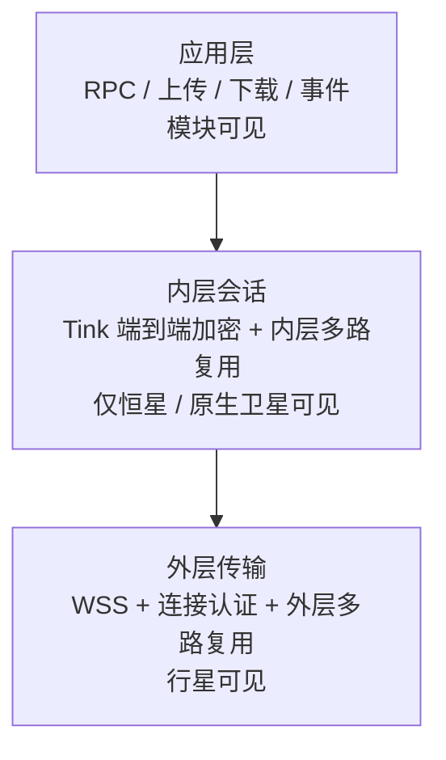
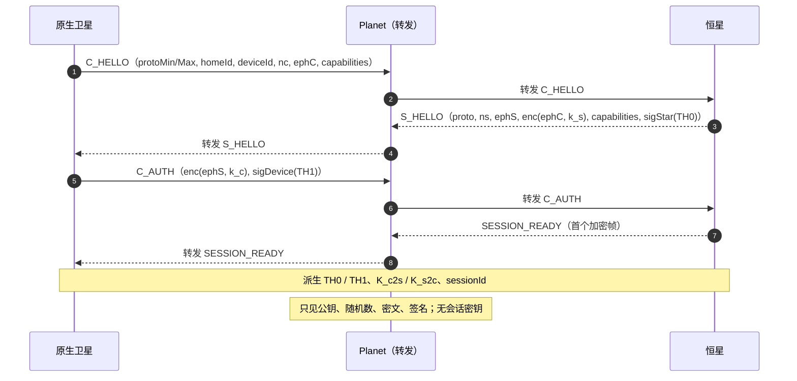
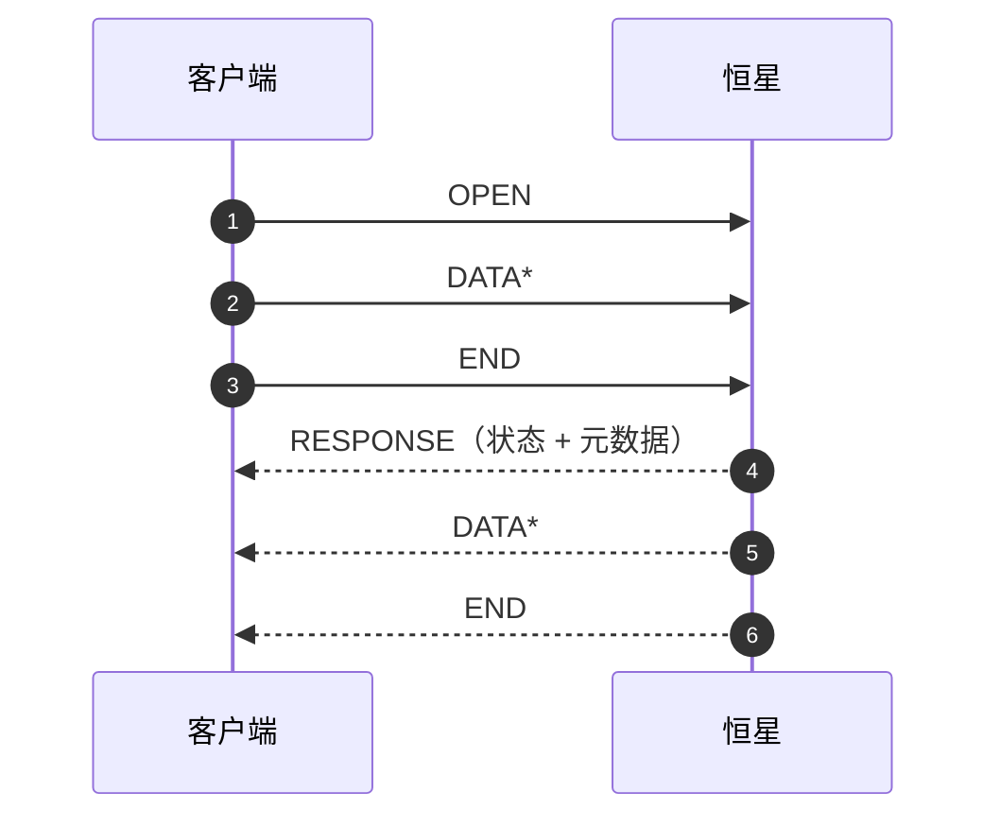
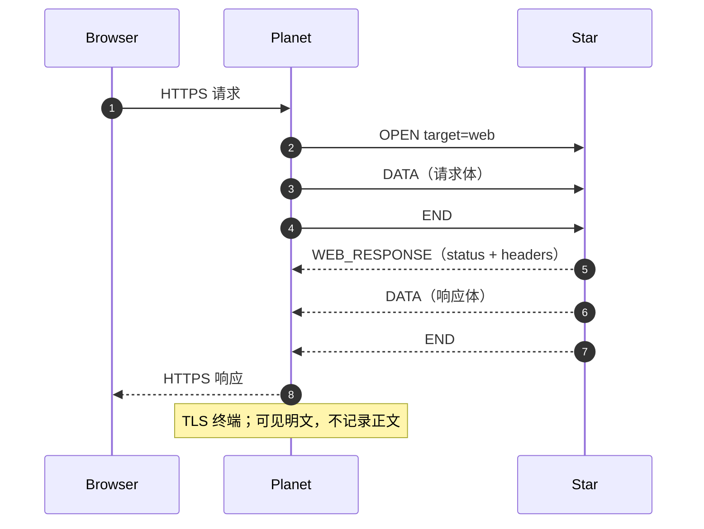

# 02 · 协议

本文件定义恒星、行星、卫星之间的传输协议。目标：多路复用、背压、端到端加密、可演进。

有两条数据面：

1. **原生路径**（Desktop / Android）：WSS 外层 + Tink 内层端到端会话。
2. **Web 路径**（浏览器）：行星 HTTPS 网关 + 恒星 `WEB_HTTP` 适配器；不做内层 E2E。

原生路径分三层：



- **外层**用于恒星↔行星、原生卫星↔行星、原生卫星↔恒星（LAN）。
- **内层**永远运行在一个外层逻辑流之上，恒星与原生卫星端到端。
- 行星只解析外层帧，转发 `DATA` 字节；原生流量不接触内层明文。
- Web 路径的行星是 TLS 终端，**会看到 HTTP 明文**（见 §3.6）。

---

## 1. 外层传输

### 1.1 传输

- WSS（TLS 1.3 优先），二进制消息。
- 一条 WebSocket 消息 = 一个外层帧。
- 最大帧负载 64 KiB；WebSocket 最大消息限制设为 `12 + 64 KiB`。
- 控制帧用 CBOR 编码；`DATA` 为原始字节。

### 1.2 外层帧

```
offset  size  field
0       1     version        // 1
1       1     type
2       2     flags          // 保留，置 0
4       4     streamId       // BE
8       4     length         // payload 长度，BE
12      N     payload
```

### 1.3 帧类型

| 值 | 名称 | 方向 | 说明 |
|---|---|---|---|
| 0x01 | `HELLO` | 双向 | 协议版本范围、随机 nonce |
| 0x02 | `HELLO_ACK` | 双向 | 选定版本、服务端 nonce |
| 0x03 | `REGISTER` | 恒星→行星 | `homeId` + 公钥 + 对 nonce 的签名 |
| 0x04 | `REGISTER_OK` | 行星→恒星 | 注册结果 |
| 0x05 | `OPEN` | 原生卫星→行星/恒星；行星→恒星（Web） | 打开逻辑流 |
| 0x06 | `OPEN_OK` | 对端 | 流已建立 |
| 0x07 | `OPEN_REJECT` | 对端 | 拒绝及原因 |
| 0x08 | `DATA` | 双向 | 流字节 |
| 0x09 | `END` | 双向 | 半关闭 |
| 0x0A | `RESET` | 双向 | 异常终止 |
| 0x0B | `WINDOW` | 双向 | 流控信用 |
| 0x0C | `PING` | 双向 | 保活 |
| 0x0D | `PONG` | 双向 | 保活应答 |
| 0x0E | `GOAWAY` | 双向 | 优雅关闭连接 |
| 0x0F | `ERROR` | 双向 | 连接级错误 |
| 0x10 | `WEB_RESPONSE` | 恒星→行星 | Web 网关响应头（状态 + headers） |

### 1.4 连接建立

#### 恒星 → 行星

1. TLS 建立；恒星校验行星证书（公共 CA 或固定指纹）。
2. 行星发 `HELLO { nonce_s, protoMin, protoMax }`。
3. 恒星回 `HELLO_ACK { proto, nonce_s }`。
4. 恒星发 `REGISTER { homeId, starId, proto, signature }`。
   - `starId` = 恒星签名公钥指纹，用于密钥轮换与区分同一 `homeId` 的不同密钥。
   - `signature` = 恒星长期 Ed25519 私钥对 `"register" || homeId || nonce_s || proto` 的签名。
5. 行星用注册表中该 `homeId` 的公钥验签；成功回 `REGISTER_OK { topoHint? }`。
6. 隧道进入长期在线；双方每 20s `PING`，60s 无响应断开。

行星侧注册表来源：行星配置文件（`homes.toml`）或管理员 RPC。行星是用户自己的服务器，不做开放注册。

#### 原生卫星 → 行星

1. TLS 建立；原生卫星校验证书（公共 CA 或固定指纹）。
2. 行星先发 `HELLO`；原生卫星回 `HELLO_ACK`，协商版本与 nonce。
3. 原生卫星发 `OPEN { target = homeId, sessionNonce, proto }`。
4. 行星查 `homeId` 是否有在线隧道：
   - 有：行星在隧道上以**服务端发起的偶数流**向恒星发 `OPEN { target = "session", satelliteHint? }`；恒星回 `OPEN_OK`；行星再向原生卫星回 `OPEN_OK { streamId }`。
   - 无：`OPEN_REJECT { code = HOME_OFFLINE }`。
5. 之后行星把原生卫星该流的 `DATA` 原样转发到恒星的对应流，反向亦然。

> 隧道连接中恒星是客户端（奇数流）、行星是服务端（偶数流）；原生卫星到行星的连接中原生卫星是客户端（奇数流）。行星负责两侧流 ID 的映射。

行星不解析内层内容；只做流级别的转发、窗口与限流。两侧窗口独立维护：只有在对端有信用时才转发 `DATA`，并在字节被消费后向来源回 `WINDOW`，避免一侧慢消费者拖垮整条隧道。

Web 流是例外：行星以 `OPEN { target = "web", ... }` 发起外层流，恒星用 `WEB_RESPONSE` 返回状态与响应头，之后 `DATA` 承载 HTTP 正文；不做内层会话。详见 §3.6。

#### 原生卫星 → 恒星（LAN 直连）

1. TLS 建立；原生卫星固定恒星 LAN 证书指纹（配对时获得）。
2. 恒星先发 `HELLO`；原生卫星回 `HELLO_ACK`。
3. 原生卫星发 `OPEN { target = "star", sessionNonce, proto }`。
4. 恒星回 `OPEN_OK`。
5. 与中继路径完全一致：内层会话在该流上运行。

> 直连也启用内层加密，保持单一代码路径，并防止局域网窃听。

### 1.5 多路复用与流控

- 流 ID：客户端发起奇数，服务端发起偶数；31 位；耗尽后 `GOAWAY`。
- 每条流初始发送窗口 **256 KiB**。
- 发送方每发一个 `DATA`，扣减窗口；窗口不足则等待。
- 接收方消费后发 `WINDOW { credit }`。
- 单连接最多 **64** 条并发流；单条流单帧 ≤ 64 KiB。
- 行星对每个 home 的缓冲上限（建议 16 MiB）与每流上限（建议 1 MiB）；超限 `RESET { RESOURCE_EXHAUSTED }`。
- `END` 表示该方向不再发送；双向都 `END` 后流关闭。
- `RESET` 立即终止并释放缓冲。

### 1.6 保活与关闭

- `PING` 每 20s；60s 未收到任何帧则判定断线。
- `GOAWAY` 后不再接受新流，已有流允许在超时内完成。
- 行星重启会断开所有隧道；恒星与原生卫星按退避重连。

---

## 2. 内层端到端会话

### 2.1 位置

内层会话仅用于**原生卫星**，运行在**一个外层流**内。外层 `streamId` 只用于传输路由（行星可能重新映射 ID）；会话绑定由握手 transcript 派生的 `sessionId` 完成，防止跨会话拼接。

外层 `DATA` 的内容就是内层记录：

```
u8   recordType    // 1 = 握手, 2 = 加密帧, 3 = 配对请求, 4 = 配对响应
u32  length        // BE
N    payload
```

握手记录为 CBOR；加密帧为 AEAD 密文。配对记录见 §2.1.1。

### 2.1.1 配对记录

配对发生在正常会话握手之前，使用一次性逻辑流：

```
recordType 3  PAIR_REQ
  payload = HybridEncrypt(starHpk, CBOR {
      token, devicePub, deviceName, platform, nonce
  })

recordType 4  PAIR_OK
  payload = CBOR {
      homeId, topology, requestHash, sigStar
  }
```

- 原生卫星从二维码取得 `starHpk`（恒星长期 HybridEncrypt 公钥）；请求端到端加密。
- 恒星校验令牌后保存设备公钥，用长期 Ed25519 私钥签名 `requestHash` 与响应。
- 原生卫星校验 `sigStar` 与 `requestHash`，确认响应属于本次请求。
- 恶意行星无法读取令牌或替换设备公钥，只能丢弃/延迟。
- 配对完成后关闭该流；后续连接走正常会话握手。

### 2.2 长期身份

配对时交换：

- 恒星：Tink Ed25519 公钥（二维码中的 `pk`）+ LAN 证书指纹（`fp`）。
- 原生卫星：Tink Ed25519 公钥（配对请求中提交）。

长期密钥只用于**签名/身份认证**，不用于加密业务数据。

### 2.3 会话握手

每次连接生成新的临时混合加密密钥对（Tink `HybridEncrypt`，X25519 + HKDF + AES-GCM）。三条握手消息 + 首个加密帧：



字段说明：

- `nc` / `ns`：32 字节随机数。
- `ephC` / `ephS`：客户端 / 恒星的临时 Hybrid 公钥 keyset。
- `enc(ephX, k)`：用对端临时公钥加密 32 字节随机密钥。
- `sigStar(TH0)` / `sigDevice(TH1)`：恒星 / 原生卫星的长期 Ed25519 签名。
- `capabilities`：能力集合；transcript 中使用其规范 CBOR 字节。

transcript 使用**长度前缀的字段字节**，不依赖 CBOR 重新序列化：

```
lp(x) = u32(len(x)) || x

TH0 = SHA-256(
  "home-erp/session/v1"
  || u16(protoMin) || u16(protoMax)
  || lp(homeId) || lp(deviceId)
  || nc (32B)
  || lp(ephC) || lp(capC)
  || u16(proto)
  || ns (32B)
  || lp(ephS) || lp(enc_s) || lp(capS)
)

TH1 = SHA-256(TH0 || lp(enc_c))
```

- `capC` / `capS` 为 capabilities 的规范 CBOR 字节。
- 双方必须使用收到的原始字段字节计算，不得先解析再重新编码。
- `sigStar` 不参与 TH0；`sigDevice` 不参与 TH1。

会话密钥：

```
PRK       = HKDF-Extract(salt = TH1, ikm = k_c || k_s)
K_c2s     = HKDF-Expand(PRK, "home-erp c2s", 32)
K_s2c     = HKDF-Expand(PRK, "home-erp s2c", 32)
sessionId = TH1 的前 16 字节
```

安全属性：

- **双向认证**：原生卫星验 `sigStar`（二维码中的恒星公钥）；恒星验 `sigDevice`（配对时保存的设备公钥）。
- **设备绑定**：恒星校验 `deviceId` 已配对到 `homeId`；未知设备拒绝。
- **前向保密**：临时 Hybrid 密钥 + 随机密钥材料；长期密钥泄露不影响历史会话。
- **密钥贡献**：双方各提供 32 字节随机量。
- **重放**：`nc` / `ns` + 签名 + 时间窗口；恒星对同一 `(deviceId, nc)` 做短期去重缓存。
- **降级**：协议版本范围取交集；无交集则 `VERSION_MISMATCH`。

握手消息在行星侧可见（公钥、随机数、密文、签名），但不含会话密钥。

### 2.4 加密帧

握手完成后，每条内层帧：

```
明文 = u8 version | u8 type | u16 flags | u32 streamId | u32 length | payload
密文 = AEAD-AES-256-GCM(K_dir, nonce, AAD, 明文)
记录 = u32 密文长度 | 密文
```

- 方向密钥：`K_c2s` / `K_s2c`。
- Nonce（12 字节）= `direction (4B: 0x00000000 / 0x00000001) || counter (8B BE)`。
- `counter` 从 0 严格递增；接收方拒绝重复或跳号（外层流是有序的）。
- AAD = `sessionId (16B) || direction (1B) || 明文字节长度 (4B)`。
- 最大明文 64 KiB；密文长度上限 `64 KiB + 16`。
- 会话上限：12 小时 / `2^31` 条记录 / 8 GiB；任一到达前重新握手。
- 不实现会话恢复（v1）；断线重连 = 新握手。

### 2.5 内层帧类型

| 值 | 名称 | 说明 |
|---|---|---|
| 0x01 | `OPEN` | 打开应用流（RPC/上传/下载/事件） |
| 0x02 | `RESPONSE` | 响应头：状态 + 元数据 |
| 0x03 | `DATA` | 流字节 |
| 0x04 | `END` | 半关闭 |
| 0x05 | `RESET` | 取消/异常 |
| 0x06 | `WINDOW` | 流控 |
| 0x07 | `PING` | 内层保活 |
| 0x08 | `PONG` | 内层保活应答 |
| 0x09 | `GOAWAY` | 会话关闭 |

内层流同样有 256 KiB 初始窗口；与外层窗口叠加，保证大文件传输不会饿死交互 RPC。

---

## 3. 应用层

以下 RPC / 上传 / 下载 / 事件模型用于**原生路径**。Web 路径见 §3.6。

### 3.1 流类型

`OPEN` 的 CBOR 负载：

```json
{
  "kind": "rpc" | "upload" | "download" | "event",
  "method": "inventory.items.list",
  "metadata": { "content-type": "application/cbor", "deadline-ms": "5000", ... }
}
```

- 客户端发起：`rpc` / `upload` / `download`。
- 服务端发起：`event`（服务器推送）。
- 流 ID：客户端奇数，服务端偶数。

### 3.2 请求/响应模型

每条流是「请求半边 + 响应半边」：



- `RESPONSE` 的 CBOR：

```json
{ "status": 0, "code": "OK", "message": "", "metadata": { "content-type": "application/cbor" } }
```

- 状态码沿用 gRPC 语义（0 OK、3 INVALID_ARGUMENT、7 PERMISSION_DENIED、15 UNAUTHENTICATED、16 VERSION_MISMATCH 等）。
- 请求体/响应体默认 CBOR；模块 DTO 用 kotlinx.serialization。
- 事件：恒星发 `OPEN(kind=event)` + `DATA` + `END`；原生卫星回 `RESPONSE` + `END` 作为确认。
- 取消：任一方 `RESET { code = CANCELLED }`。
- 超时：`deadline-ms` 元数据；两端都执行。

### 3.3 上传与下载

**上传**

1. 客户端 `OPEN(kind=upload, method, metadata { size, sha256, offset })`。
2. 恒星校验权限与配额。
   - 可接受：`RESPONSE(status=OK, metadata { acceptedOffset })`，客户端从 `acceptedOffset` 发送 `DATA`。
   - 不可接受/偏移不符：`RESPONSE(status=CONFLICT, metadata { acceptedOffset })` + `END`，客户端用新流从该偏移重试。
3. 客户端 `DATA*` + `END`。
4. 恒星校验长度与 `sha256`，写临时文件后原子落盘。
5. 最终结果放在恒星的 `END` 元数据：`{ status, code, key, sha256, size }`。

**下载**

1. 客户端 `OPEN(kind=download, method, metadata { key, offset? })`。
2. 恒星 `RESPONSE(status=OK, metadata { size, sha256, content-type })`。
3. `DATA*` + `END`。

- 分块 64 KiB；断点续传用 `offset`。
- 附件内容寻址（见 [04-data.md](04-data.md)），上传完成后按 `sha256` 去重。

### 3.4 重试与幂等

- 修改类 RPC 建议带 `idempotency-key`；恒星缓存结果 10 分钟（按设备 + key）。
- 仅 `UNAVAILABLE` / `DEADLINE_EXCEEDED` 自动重试；其他错误交由 UI。
- 上传/下载依赖偏移与哈希，可安全重试。
- 断线时未完成流全部 `RESET`；客户端按业务语义决定是否重发。

### 3.5 版本协商

- 外层：`HELLO` 交换 `protoMin/protoMax`，取最高交集。
- 内层：`C_HELLO` 交换 `protoMin/protoMax`；同时携带 `clientApiVersion`。
- 模块：`manifest.api.star` / `client` 是整数主版本；宿主只加载支持范围内的模块。
- RPC 方法名稳定；破坏性变更用 `.v2` 后缀或新方法名，旧方法保留至少一个大版本。
- Web：API 前缀 `/api/web/v1/`；请求带 `X-Web-Version`，恒星拒绝不兼容的壳版本。

### 3.6 Web 网关（行星 HTTPS → 恒星）

Web 路径不使用内层 E2E。行星终止 TLS，把浏览器 HTTP 请求映射为恒星隧道上的外层 `WEB_HTTP` 流。

#### 请求映射

行星向恒星发起外层流：

```
OPEN {
  target: "web",
  method: "GET" | "POST" | ...,
  path: "/api/web/v1/...",
  headers: [[name, value], ...],   // 保留重复头（Set-Cookie 等）
  remote: "<client ip>",
  httpVersion: "HTTP/1.1"
}
DATA (请求体)*
END
```

恒星响应：

```
WEB_RESPONSE { status: 200, headers: [[name, value], ...] }
DATA (响应体)*
END
```



- 对 `target=web`，`WEB_RESPONSE` 同时充当 `OPEN_OK`：收到即表示流已接受并携带响应头；拒绝用 `OPEN_REJECT`。
- 请求/响应体都流式传输；行星不得整体缓冲大文件。
- 恒星可在读完请求体前返回错误（如 401/413）：发 `WEB_RESPONSE` + `END`，行星停止转发并关闭请求体。
- 行星剥离 hop-by-hop 头，补充 `X-Forwarded-For` / `X-Forwarded-Proto: https` / `X-Forwarded-Host`。
- 行星只服务已注册的 `homeId`；未知 home 返回 `404`，恒星离线返回 `503`。
- 行星不得记录请求/响应体、Cookie、Authorization；访问日志脱敏。

#### 恒星侧路由

| 路由 | 用途 |
|---|---|
| `GET /` | Web 壳 `index.html`（no-cache） |
| `GET /assets/*` | 静态资源（哈希文件名，immutable） |
| `POST /api/web/v1/auth/login` | 登录，设置会话 Cookie |
| `POST /api/web/v1/auth/logout` | 注销 |
| `GET /api/web/v1/me` | 当前用户/角色/CSRF token |
| `POST /api/web/v1/rpc` | 通用 RPC（JSON） |
| `POST /api/web/v1/upload` | 流式上传 |
| `GET /api/web/v1/download` | 流式下载 |
| `GET /api/web/v1/health` | 恒星/网关健康 |

RPC 信封：

```json
// 请求
{ "method": "inventory.items.list", "metadata": {}, "payload": { } }

// 响应
{ "status": 0, "code": "OK", "message": "", "metadata": {}, "payload": { } }
```

- 服务端模块用同一个 `RpcRegistry`；`req.decode<T>()` 同时支持 JSON 与 CBOR。
- 权限仍由恒星裁决；Web 壳不持有额外权限。
- 静态资源与 API 同源，无 CORS；禁止第三方脚本。

#### 认证与会话

- 浏览器用账号密码登录（`auth` 模块）；**不做设备配对**。
- 登录成功：恒星签发 256-bit 随机会话令牌，DB 只存哈希；`Set-Cookie: __Host-homerp_web=<token>; Path=/; Secure; HttpOnly; SameSite=Strict`。
- 同时下发 CSRF token（`__Host-homerp_csrf`，非 HttpOnly）；修改类请求必须带 `X-CSRF-Token`，并校验 `Origin`/`Referer` 与 `Host` 一致。
- 会话：默认 12h 绝对过期 + 30min 空闲过期；可在「会话/设备」页撤销。
- 登录限流、失败锁定；首次管理员必须由已配对的原生卫星创建。
- 行星可见 Cookie 与密码（TLS 终端）；这是 Web 网关的信任代价。
- Web 会话与原生设备会话分开管理；撤销即时生效。

#### 安全响应头

恒星设置：

```
Content-Security-Policy: default-src 'self'; script-src 'self'; style-src 'self';
  img-src 'self' data:; connect-src 'self'; frame-ancestors 'none';
  base-uri 'none'; form-action 'self'; object-src 'none'
X-Content-Type-Options: nosniff
Referrer-Policy: no-referrer
Permissions-Policy: camera=(), microphone=(), geolocation=()
X-Frame-Options: DENY
Cache-Control: no-store            # API
```

行星补充 `Strict-Transport-Security`。

#### 限制

- 请求头 ≤ 32 KiB；请求体流式，默认上限 2 GiB。
- 普通请求超时 30s；上传/下载 1h。
- v1 不做 SSE/WebSocket 推送；页面轮询。
- **Web 端不加载 `.hmod`**；动态模块没有 Web UI。
- 行星不是开放代理；必须校验 `homeId`、限流、限制并发。

---

## 4. 常量与默认值

| 项 | 值 |
|---|---|
| 外层帧上限 | 64 KiB |
| 内层明文上限 | 64 KiB |
| 流初始窗口 | 256 KiB |
| 单连接并发流 | 64 |
| 行星每 home 缓冲 | 16 MiB |
| 行星每流缓冲 | 1 MiB |
| 保活间隔 / 超时 | 20s / 60s |
| 握手超时 | 10s |
| 会话上限 | 12h / 2^31 帧 / 8 GiB |
| 重连退避 | 1s → 30s，指数 + 抖动 |
| 内层协议版本 | 1（当前） |
| Web 请求头上限 | 32 KiB |
| Web 请求体上限 | 2 GiB（流式） |
| Web 普通请求超时 | 30s |
| Web 上传/下载超时 | 1h |
| Web 会话 | 12h 绝对 / 30min 空闲 |

---

## 5. 一致性与测试

协议实现必须有：

1. **帧编解码往返**：边界长度、非法长度、未知类型。
2. **多路复用**：并发流、交错 DATA、半关闭、RESET。
3. **流控**：窗口耗尽阻塞、WINDOW 恢复、慢消费者。
4. **握手**：正常、签名错误、版本不匹配、重放、截断。
5. **加密**：nonce 递增、重放拒绝、AAD 绑定 `sessionId`、篡改检测。
6. **端到端**：内存中模拟行星转发，验证行星无法解出原生内层明文。
7. **故障**：断线重连、上传续传、超时、半开连接。
8. **模糊测试**：帧解析与 CBOR 解码。
9. **Web 网关**：重复头、流式上传/下载、Cookie/CSRF、路径穿越、开放代理拒绝、请求体上限、离线 503、静态缓存。
10. **Web 安全**：CSP 头、Cookie 属性、Login 限流、会话撤销、XSS 转义。

协议变更必须同时更新本文件与一致性测试。
