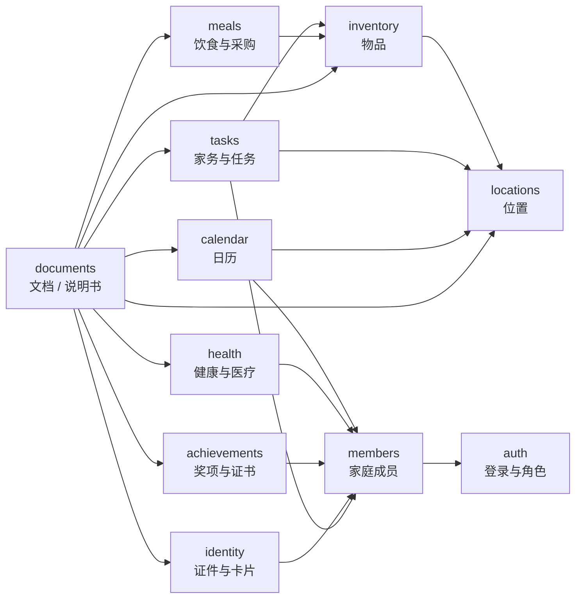

# 08 · 领域地图（草案）

> 状态：draft v0.1。先对齐边界与术语；模块细节见 [modules/](modules/)。

## 1. 模块分类

| 模块 ID | 产品名 | 类型 | 状态 | 拥有 |
|---|---|---|---|---|
| `members` | 家庭成员 | core | planned | 人员资料、家庭关系 |
| `auth` | 登录与角色 | core | planned | 账号、角色、会话 |
| `locations` | 位置 | core | draft | 位置森林（多地点根） |
| `documents` | 文档与说明书 | business | draft | 文件、文档元数据、实体关联 |
| `inventory` | 物品 | business | draft | 物品主数据、库存、耐用品字段 |
| `tasks` | 家务与任务 | business | draft | 任务模板、周期、完成记录 |
| `calendar` | 日历 | business | draft | 事件、纪念日、生日、参与者 |
| `meals` | 饮食与采购 | business | draft | 菜谱、菜单、采购清单 |
| `health` | 健康与医疗 | business | draft | 人类健康记录、疫苗、用药、过敏 |
| `achievements` | 奖项与证书 | business | draft | 成员奖项、荣誉、证书、资格 |
| `identity` | 证件与卡片 | business | draft | 成员证件、通行证、社保卡、银行卡 |
| `assets` | 资产 | deferred | — | 暂并入 `inventory.kind=durable`，后续再评估拆分 |

- **core**：内置、默认启用；其他模块可以依赖，但不建议卸载。
- **business**：可安装/卸载；只依赖 core 与其他已声明模块的稳定 API，不共享表。
- **deferred**：暂不实现，保留名字，避免以后重命名。

模块 ID 沿用现有文档的 `inventory`；对用户显示「物品」，不单独建 `items` 模块。

## 2. 关系

实线表示业务引用，不表示数据库外键。

## 3. 所有权与引用

| 模块 | 拥有的表/文件 | 只引用 |
|---|---|---|
| `locations` | `m_locations_node`（多 Level 0 根） | 无 |
| `inventory` | `m_inventory_item`、`m_inventory_lot`、`m_inventory_movement` | `location_id` |
| `documents` | `m_documents_doc`、`m_documents_link`、`files/` | `target_type` + `target_id` |
| `tasks` | `m_tasks_template`、`m_tasks_occurrence`、`m_tasks_completion` | `assignee_id`、`subject_type` + `subject_id` |
| `calendar` | `m_calendar_event`、`m_calendar_event_member` | `member_id`、`location_id` |
| `meals` | `m_meals_recipe`、`m_meals_recipe_ingredient`、`m_meals_plan`、`m_meals_grocery_item` | `inventory_item_id`、`recipe_id` |
| `health` | `m_health_record` | `member_id` |
| `achievements` | `m_achievements_record` | `member_id` |
| `identity` | `m_identity_record` | `member_id` |
| `members` | 人员与家庭关系 | 无 |
| `auth` | 账号、角色、会话 | `member_id` |

规则：

- **不共享业务表**；跨模块只传逻辑 ID，不建跨模块外键。
- 「某位置有什么」由 `inventory` 按 `location_id` 查询，`locations` 不存物品。
- 位置森林允许多个 Level 0 地点（自己家、老家、工作地、伴侣住处）；根之间平级。
- 说明书的文件与关联由 `documents` 拥有；`inventory` 只在详情页调用 `documents` RPC。
- 任务完成记录由 `tasks` 拥有；不要在其他模块复制「已完成」状态。
- 事件、纪念日、生日由 `calendar` 拥有；日历只读叠加 `tasks` 到期项，不复制任务。
- 菜谱、菜单、采购清单由 `meals` 拥有；库存数量仍由 `inventory` 拥有，采购任务仍由 `tasks` 拥有。
- 人类健康记录由 `health` 拥有；默认私密，预约归 `calendar`，提醒归 `tasks`，报告归 `documents`。
- 奖项/证书记录由 `achievements` 拥有；证书扫描件与关联由 `documents` 拥有。
- 证件/卡片记录由 `identity` 拥有；只存掩码/后四位，完整信息看扫描件。
- 水印分享由 `documents` 生成；`identity` 只提供入口与上下文，不复制文件。
- 跨模块展示数据可以短 TTL 缓存；写操作必须回到拥有者。

## 4. 跨模块流程

跨 2 个以上模块的流程放 [flows/](flows/)，不要塞进某个模块卡。当前示例：

- [appliance-manual.md](flows/appliance-manual.md)：新增电器并归档说明书。

## 5. 待确认

- `inventory` 与 `assets` 是否最终拆分；v1 先按 `inventory.kind=durable` 处理。
- 位置移动历史归 `locations` 还是 `inventory`；当前倾向由 `inventory` 的库存流水记录。
- 说明书是否做 OCR/全文搜索；v1 先按标题、类型、语言、关联实体搜索。
- 任务完成是否允许照片；若允许，照片作为 `documents` 关联，不复制文件。
- 证书到期是否由 `tasks` 自动生成提醒。
- 共同获奖是否需要一条记录关联多个成员。
- 证件/银行卡完整号码是否需要宿主加密字段。
- 证件到期是否由 `tasks` 自动生成提醒。
- 水印分享是否需要持久化分享记录与撤销入口。
- 日历是否支持农历、单次例外、私密事件。
- 日历中的任务叠加是否允许直接改期，还是只读。
- 菜单计划是否显示在日历主视图；v1 先留在 `meals`。
- 采购清单是否与库存的购物清单合并；v1 由 `meals` 独占。
- 健康记录是否需要字段级加密、更细的成员 ACL、管理员破窗。
- 健康预约/提醒是否允许从健康模块直接创建，还是只跳转。
