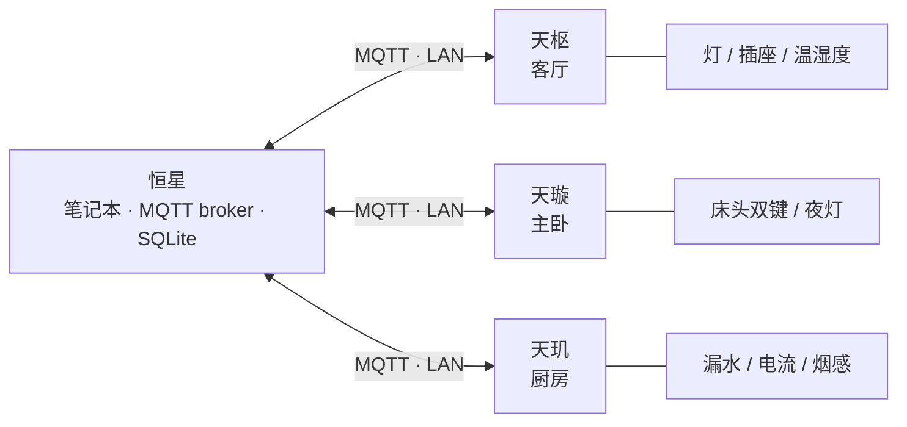

# smart_home · 房间星节点（Room Node）

> 状态：draft ｜ 适用范围：分布式 I/O 节点 ｜ 关联：[../smart_home.md](../smart_home.md)、[spi.md](spi.md)、[diy.md](diy.md)

## 1. 命名与定位

- **星群（Cluster）**：由恒星直接管辖的固定 I/O 节点集合。
- **星节点（Room Node）**：星群中的单个节点，通常对应一个房间或一个区域。
- 恒星、行星、卫星是 ERP 协议栈里的角色；星群不是，它只在部署了 `smart_home` 房间节点时存在。

术语来源：借用天文中「星群 / asterism」的意象——一组有名字、可辨认、但不构成正式星座的小星。注意 **星群不是 `star cluster`**，后者在中文是「星团」（疏散星团 / 球状星团）；星群对应 asterism，典型例子就是北斗七星。英文与代码仍使用计算术语 `cluster` / `node`，二者不是严格互译，文档里不写「星群 = star cluster」。

这个意象恰好贴合房间节点：每个节点有自己的名字（天枢、天璇……或房间名），合起来是家里认得出的一组小星，不构成新的层级，也不承担决策。

一句话：**恒星是唯一大脑，星群是它的末梢。星群只负责感知与执行，不思考、不存储业务数据。**

## 2. 职责边界

**做**：

- 采集：按键、门磁、人体、温湿度、光照、电流、漏水、振动。
- 消抖、限频、边沿检测与最小本地状态机。
- 执行：继电器、红外、PWM、干接点。
- 本地兜底：断网时物理开关与固定本地规则仍然可用。
- 事件缓存与重放、心跳与在线状态。
- 报告自身健康：固件版本、信号强度、启动 ID、运行时长。

**不做**：

- 不做场景、联动与自动化判定；决策只在恒星。
- 不写业务数据库，不存成员、权限、历史与家庭配置。
- 不接公网、不做端口映射、不接厂商云。
- 不接摄像头与麦克风；不做人脸/语音识别。
- 不作为安全联锁：漏水、过热、干烧、门锁仍靠独立硬件保护（见 [diy.md](diy.md)）。
- 不对外提供 ERP RPC；节点只讲 MQTT。
- 不做用户界面；节点没有屏幕与账号体系。

## 3. 参考拓扑



- broker 跑在恒星上，只监听局域网；星节点主动连恒星，恒星不主动扫节点。
- 节点之间不互相通信；跨房间联动由恒星编排。
- 一个节点故障只影响自己名下的端点。

## 4. 硬件参考

| 场景 | 推荐 | 说明 |
|---|---|---|
| 默认房间节点 | ESP32-C3 / S3 | Wi-Fi、GPIO 够用、成本低；注意供电与 TLS 内存 |
| 固定位置、要求稳定 | ESP32 + W5500 以太网，或 PoE | 多一根网线，换掉 Wi-Fi 抖动 |
| 极简按键/传感器 | Pi Pico W | 3.3V 友好；MQTT 生态弱于 ESP32 |
| 纯 I/O 扩展 | Arduino Nano / Pro Mini | 只能挂在 ESP32/Pico 后面当扩展，不作网络节点 |
| 电池传感器 | Zigbee / Thread 设备 | 经网关接入，不计入星群 |

硬件与安装规则：

- 床头双键：节点放床边，按键线控制在 1–2 m；不要把长线一路拉回恒星。
- 长线（>3 m）用双绞/屏蔽线，屏蔽层单端接地；远离市电与电机线。
- 常开按键接 GND + 10k 上拉 + 1k 串阻 + 100nF 到地；干扰大时加施密特触发或光耦。
- 断线必须读成「未按下」，不能读成「按下」；常开接 GND + 上拉满足这一点。
- 5V 器件（Nano）不能直连 3.3V GPIO；用 USB 串口或电平转换。
- 强电继电器板必须认证、隔离、阻燃、带保险，由电工安装；不放在床头或木柜里。
- 开关盒没有零线时，优先智能插座/智能灯泡，不硬上无零线开关。
- 节点供电用认证电源并加保险；不要用裸降压模块直接接市电。

## 5. 固件职责

- 启动：读持久化配置 → 连 broker → 发布 `availability=online`（retain）。
- 消抖 20–50 ms，按下沿触发一次；已处于同一状态时重复按下忽略。
- 事件带 `node`、`boot`、`seq`、`ms`、`endpoint`、`type`、`value`。
- 断网缓存：固定容量环形缓冲（如 256 条）；满了丢最旧，并在下一条消息里上报 `dropped` 计数。
- 命令：校验参数 → 执行 → 回 `ack`（`seq`、`ok`、`error`、`elapsed_ms`）。
- 看门狗 + 启动 ID；崩溃重启后 `boot` 变化，`seq` 从 0 重新开始。
- 时间：节点不依赖 RTC；`ms` 是开机毫秒，恒星用 `received_at` 记录真实时间。节点若已对时，可附带 `at`（epoch ms）作为提示，不作为权威。
- 固件版本只读上报；v1 不做 ERP 触发 OTA。

## 6. MQTT 契约

| Topic | retain | QoS | 说明 |
|---|---|---|---|
| `home/<node>/availability` | 是 | 1 | `online` / `offline`；LWT 设 `offline` |
| `home/<node>/state/<endpoint>` | 是 | 1 | 最后已知状态 |
| `home/<node>/event/<endpoint>` | 否 | 1 | 瞬时事件，如按键 |
| `home/<node>/cmd/<endpoint>` | 否 | 1 | 恒星 → 节点 |
| `home/<node>/ack` | 否 | 1 | 节点 → 恒星，命令结果 |
| `home/<node>/meta` | 是 | 1 | 固件、型号、端点清单 |

事件与命令建议信封：

```json
{
  "v": 1,
  "node": "tianshu",
  "boot": "8f3a",
  "seq": 42,
  "ms": 12345,
  "endpoint": "button.sleep",
  "type": "press",
  "value": "short"
}
```

规则：

- `node` 用小写 ASCII 短名，稳定不变；中文名与房间名在 ERP 侧映射，不进 topic。
- 端点命名 `<类别>.<用途>`，如 `button.sleep`、`relay.light1`、`sensor.temp`。
- 命令和事件不 retain：避免节点重启后重放旧命令。
- `state` retain 只为新订阅者立刻拿到最后值；ERP 落库后以 `DeviceState` 为准。
- 每节点独立凭据，ACL 只允许 `home/<nodeId>/#` 的读写；禁止通配符写。
- broker 只监听本地/IoT VLAN，关闭公网映射、UPnP 与 WPS。
- 命令带 `idempotencyKey`，事件带 `seq`；ERP 按 `(node, boot, seq)` 去重。
- broker 不做长期历史；持久化在 ERP。

## 7. 映射到 ERP

- 一个星节点 = 一个 `AdapterInstance`（`driverId=mqtt.local`）。
- 节点上的一个逻辑设备 = 一个 `Device`；一个节点可以承载多个 `Device`。
- 端点 = `DeviceBinding.nativeId = <nodeId>/<endpoint>`。

| 星节点概念 | ERP 概念 | 说明 |
|---|---|---|
| nodeId | `AdapterInstance.id` / broker clientId | 连接与凭据单位 |
| endpoint | `DeviceBinding.nativeId` | `adapterId + nativeId` 唯一 |
| 端点能力 | `Capability` | 复用 SPI 能力，不新增协议字段 |
| 节点在线 | `AdapterInstance.status` | 离线时相关能力置 `unknown` |
| 固件/信号 | `Device.metadata_json` | 只读展示，不参与策略 |

建议 Profile：

- `panel.sleep`：`button_event`
- `sensor.env`：`sensor_value`（温度、湿度、光照）
- `sensor.motion`：`sensor_value`（人体）
- `sensor.contact`：`sensor_value`（开合）
- `switch.relay`：`power`、`brightness`
- `ir.blaster`：`power`、`target_temperature`、`hvac_mode`、`fan_speed`

新增能力建议：

- `button_event`：只读事件流，`short_press` / `long_press` / `double_press`；与 `door_event` 同类，是事件不是状态。
- `node_health`：只读 `online`、`rssi`、`firmware`、`uptime_sec`、`boot_id`。
- 其余复用已有能力；核心不出现 `esp32.*`、引脚号或厂商字段。

## 8. 状态与离线

- `reported`：节点直接上报的状态（继电器回读、传感器读数）。
- `inferred`：由事件推断（按键 →「已上床」），必须标 `inferred` 并带 `observed_at`。
- `optimistic`：命令发出后的临时状态，节点 `ack` 或 `state` 回传后校准。
- `availability=offline` 时相关能力置 `unknown` 并保留 `last_seen`；UI 不显示「已关闭」。
- 离线期间的事件由节点缓存，重连后按 `seq` 重放；超出缓存的部分丢失，ERP 记 `dropped` 并提示。
- 节点重启：`boot` 变化，ERP 不把新的 `seq=1` 当成重复。
- 跨节点顺序以 ERP 的 `received_at` 为准；节点时钟不可信。

## 9. 本地兜底

- 物理开关直接控制负载，不经过节点；断网、恒星关机、节点重启都还能开灯。
- 节点保存最后状态，但重启后不自动执行高风险动作。
- 断网时节点只跑固定本地规则：按键开灯、门磁本地蜂鸣；不做条件联动。
- 恒星恢复后以节点 `reported` 覆盖 `optimistic`；冲突记录事件，不静默改历史。
- 漏水、烟雾、过热、加热类保护由独立硬件完成，不经 ERP 命令链。
- 恒星离线超过阈值时，节点继续本地控制，UI 显示「降级运行」。

## 10. 安全

- 每节点独立凭据；撤销节点 = 删 ACL + 禁用 clientId + 归档绑定，历史保留。
- 节点固件不存家庭密钥、成员数据与业务配置；只存 broker 地址、自身凭据与端点表。
- 新节点上线只进入候选，必须在原生端确认后才成为受管设备。
- 节点凭据只用于 MQTT，不作为用户身份，不参与原生配对。
- 节点位置可推断作息与家中是否有人：默认仅家庭成员可见，不进 Web。
- 日志不记录按键精确时间、事件 payload 与凭据；只记节点、端点、结果与耗时。
- 固件升级 v1 不做 OTA，由用户本地刷写；版本只读上报。

## 11. 分阶段落地

1. **P0 单节点只监测**：床头双键 + 温湿度，一个节点、一个房间，只记录不控制。
2. **P1 多房间**：3–5 个节点，availability、事件缓存与重放、离线状态。
3. **P2 低风险控制**：灯、插座、红外空调，命令走 `Capability` 与策略层。
4. **P3 本地兜底**：物理开关、断网本地规则、降级提示。
5. **P4 强电与传感器扩展**：认证继电器、漏水/电流/烟感，由电工施工。
6. 高风险负载（加热、洗衣机）按 [diy.md](diy.md) 的 L0–L3 分层，不随星节点一起放开。

## 12. 验收

- 节点上线先出现在候选；确认后才建 `AdapterInstance` 与绑定。
- 断电重启后 `nodeId`、绑定、端点不变；`boot` 变化，事件不重复。
- 断网 10 分钟的事件在恢复后按序补传；超出缓存的部分有明确丢失提示。
- 节点离线时相关能力显示 `unknown` 与 `last_seen`，不显示「已关闭」。
- 恒星关机时物理开关仍能控制灯。
- 命令发送成功但节点未 `ack` 时，状态保持 `optimistic` 并标记未确认。
- 一个节点崩溃不影响其他节点与 `smart_home` 主进程。
- 节点凭据只能读写自己的 topic 前缀；越权写入被 broker 拒绝。
- 按键长线（≥3 m）实测不误触发；断线读成「未按下」。
- Web 不显示按键时间与节点位置细节；日志不含凭据与事件 payload。

## 13. 开放问题

- 一个节点一个 `AdapterInstance`，还是一个 broker 一个再按 `nativeId` 前缀区分；v1 倾向前者。
- MQTT 是否强制 TLS 客户端证书；v1 先独立凭据 + 局域网隔离。
- 按键事件是 `DeviceEvent` 还是独立 `sleep`/`health` 记录；v1 先存事件，后续再抽模块。
- 节点是否允许跑本地自动化；v1 只允许固定本地规则，不下发用户脚本。
- 节点命名用北斗七星（天枢/天璇/…）还是房间名；v1 建议两者都存，`nodeId` 用 ASCII 短名。
- 固定节点是否统一 PoE；v1 网线优先、Wi-Fi 补充，不强求。
- 事件缓存上限与保留时长；v1 固定容量 + 丢最旧并上报 `dropped`。
- 是否支持节点 OTA；v1 不做，只报告版本。
- Zigbee/Thread 电池传感器是否算星群成员；v1 算「经网关接入的子设备」，不计入星群。
